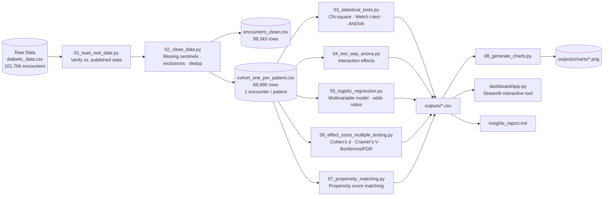
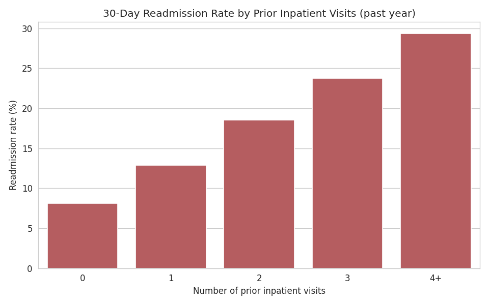
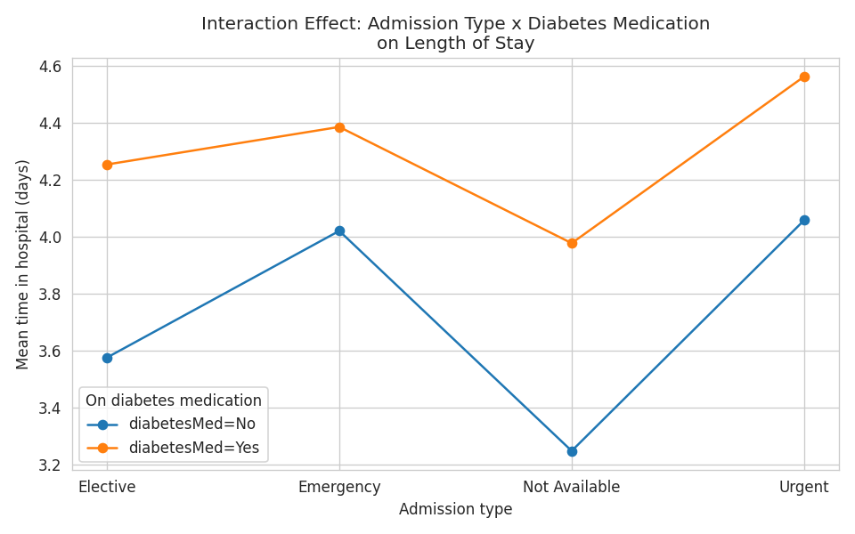
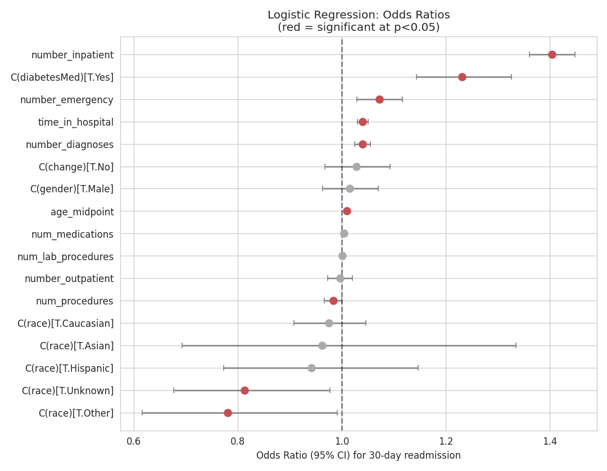
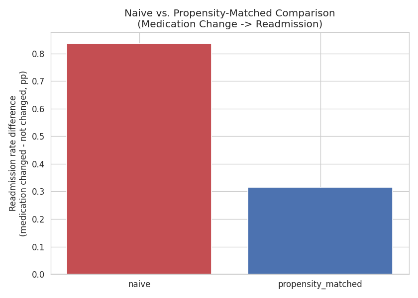
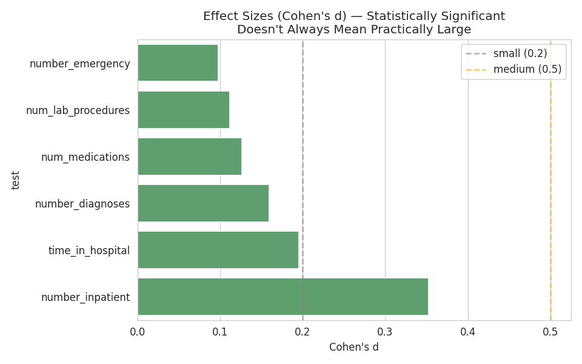

# Patient Readmission & Hospital Utilization Analytics

[](https://www.python.org/)
[](https://creativecommons.org/licenses/by/4.0/)
[]()

An end-to-end statistical analytics project on **real, verified clinical data** — 101,766
de-identified inpatient encounters across 130 US hospitals — covering data verification,
cleaning, hypothesis testing, causal-style inference, and an interactive dashboard.

> **This is real data, not synthetic.** Dataset: *"Diabetes 130-US Hospitals for Years
> 1999–2008"* (Strack, B., DeShazo, J.P., Gennings, C., et al., *BioMed Research
> International*, 2014). Source: [UCI ML Repository](https://archive.ics.uci.edu/dataset/296/diabetes+130-us+hospitals+for+years+1999-2008),
> CC BY 4.0. Row counts and readmission distribution are verified against the published paper
> in `data/01_load_real_data.py`.

---

## Problem Statement

30-day hospital readmission is a costly, closely-tracked outcome in US healthcare — CMS
penalizes hospitals with excess readmission rates under the Hospital Readmissions Reduction
Program. This project asks three questions of the data:

1. **Which patient/encounter factors are statistically associated with 30-day readmission**,
   and how large are those effects in practice (not just whether p < 0.05)?
2. **Can a discharge-time model meaningfully rank patients by readmission risk**, and which
   features drive that risk?
3. **Does a within-stay medication change causally affect readmission risk**, or is the naive
   association confounded by patient severity?

---

## Pipeline Overview



---

## Data Schema

`data/processed/cohort_one_per_patient.csv` — one row per unique patient (first encounter by
time), 51 columns. Key fields used in analysis:

| Column | Type | Description |
|---|---|---|
| `encounter_id`, `patient_nbr` | int | Unique encounter / patient identifiers |
| `race`, `gender`, `age` | categorical | Demographics (`age` as 10-year bins, e.g. `[70-80)`) |
| `age_midpoint` | float | Derived numeric midpoint of the age bin, for regression |
| `admission_type`, `discharge_disposition`, `admission_source` | categorical | Encounter context (decoded from `*_id` via `IDs_mapping.csv`) |
| `time_in_hospital` | int | Length of stay, in days |
| `num_lab_procedures`, `num_procedures`, `num_medications` | int | Utilization counts during the stay |
| `number_outpatient`, `number_emergency`, `number_inpatient` | int | Prior-year utilization counts (key predictors) |
| `number_diagnoses` | int | Count of diagnoses recorded |
| `diag_1/2/3` | ICD-9 code | Primary/secondary/tertiary diagnoses |
| `max_glu_serum`, `A1Cresult` | categorical | Glucose / HbA1c test results (mostly untested → sparse) |
| 23 medication columns (`metformin`, `insulin`, …) | categorical | `No` / `Steady` / `Up` / `Down` per drug |
| `change` | Yes/No | Whether diabetes medication was changed during the stay |
| `diabetesMed` | Yes/No | Whether the patient was prescribed any diabetes medication |
| `readmitted` | categorical | `NO` / `<30` / `>30` — raw readmission label |
| `readmit_30` | 0/1 | **Target variable**: 1 if readmitted within 30 days |

**Exclusions applied in `02_clean_data.py`:** 2,423 expired/hospice-discharge encounters removed
(readmission isn't a meaningful outcome for these); 16,773 patients with multiple encounters
deduplicated to their first encounter, since hypothesis tests assume independent observations.

---

## How to Run

```bash
pip install -r requirements.txt

python data/01_load_real_data.py                     # Verify real data integrity
python data/02_clean_data.py                          # Clean, exclude, dedupe

python analysis/03_statistical_tests.py                # Core hypothesis tests
python analysis/04_two_way_anova.py                     # Interaction effects
python analysis/05_logistic_regression.py               # Predictive model
python analysis/06_effect_sizes_multiple_testing.py     # Effect sizes + correction
python analysis/07_propensity_matching.py                # Causal-style comparison
python analysis/08_generate_charts.py                    # Charts

streamlit run dashboard/app.py                          # Interactive dashboard
```

Deploy `dashboard/app.py` free on **Streamlit Community Cloud** for a live demo link.

---

## Tech Stack

| Layer | Tool |
|---|---|
| Statistical testing | SciPy (t-test, ANOVA, chi-square), statsmodels (two-way ANOVA, logistic regression) |
| Effect sizes / correction | Custom Cohen's d / Cramér's V, `statsmodels.stats.multitest` |
| Causal-style analysis | scikit-learn (propensity model, nearest-neighbor matching) |
| Visualization | Matplotlib, Seaborn |
| Dashboard | Streamlit (includes a live hypothesis-test tool) |

---

## Results

### 1. Prior hospital utilization is the strongest predictor of readmission

Welch's t-test on `number_inpatient` vs. 30-day readmission: **t = 16.78, p < 0.0001,
Cohen's d = 0.35** — the largest effect size found across every test run in this project.



### 2. Admission type and diabetes medication interact on length of stay

Two-way ANOVA (`time_in_hospital ~ admission_type × diabetesMed`) found a significant
interaction (**F = 8.57, p = 1.1×10⁻⁵**): the gap in stay length between medicated and
non-medicated patients is nearly twice as large for elective admissions as for emergency ones.
A one-way test would have missed this entirely.



### 3. Logistic regression: what drives readmission odds, holding everything else constant

Multivariable logistic regression (AUC = 0.61, pseudo-R² = 0.021 — modest but consistent with
published literature on this exact dataset). Each additional **prior inpatient visit
multiplies readmission odds by 1.40× (95% CI: 1.36–1.45)**, the single strongest driver in the
model.



### 4. Propensity score matching: medication changes are not causal for readmission

**Naive comparison:** patients whose medication was changed had a 9.44% readmission rate vs.
8.60% for those without a change (+0.83pp) — but this is confounded, since sicker patients
both get medication changes *and* are independently more likely to be readmitted.

After matching on age, length of stay, medication count, diagnosis count, and prior
utilization (31,495 matched pairs, all covariates balanced to **SMD < 0.1**), the gap shrinks
to **+0.31pp and is no longer significant (p = 0.17)** — a textbook confounding-by-indication
pattern.



### 5. Statistical significance ≠ practical significance at n ≈ 70,000

Almost every test came back statistically significant — but almost every effect size was
negligible. `number_inpatient` is the only variable whose effect size clears even the "small"
threshold (Cohen's d = 0.35); everything else, while statistically real, is too small to act
on alone.



### Multiple-testing correction

15 hypothesis tests were run against the same dataset. Correcting for that family-wise error
rate changes which findings survive:

| Correction | Significant findings |
|---|---|
| Raw (α = 0.05) | 12 / 15 |
| Bonferroni | 11 / 15 |
| Benjamini–Hochberg (FDR) | 12 / 15 |

The `admission_type vs. readmission` test (raw p = 0.038) is the interesting edge case: it
survives FDR correction (p = 0.048) but **not** Bonferroni (p = 0.576).

Full results table: [`outputs/corrected_test_results.csv`](outputs/corrected_test_results.csv)
Full write-up with methodology, caveats, and recommendations:
[`outputs/insights_report.md`](outputs/insights_report.md)

---

## What This Project Demonstrates

- **Working with real, imperfect clinical data** — missing-value sentinels, administrative
  exclusion criteria, and non-independent repeat observations, all handled explicitly
- **Beyond single hypothesis tests** — two-way ANOVA (interaction effects) and multivariable
  logistic regression (holding confounders constant), not just isolated bivariate tests
- **Statistical maturity** — effect sizes reported alongside every p-value, multiple-testing
  correction applied to the full test family, explicit acknowledgment of what each test can
  and cannot claim
- **Causal reasoning under observational constraints** — propensity score matching to
  distinguish correlation from a defensible causal estimate, with covariate balance checks and
  an explicit statement of what confounding this can and cannot rule out
- **A genuinely interactive tool** — the dashboard runs a live t-test with live effect size on
  whatever grouping/outcome combination a stakeholder picks

## Limitations

- **Model AUC (0.61) is modest** — readmission is a genuinely hard prediction problem from
  administrative claims data alone; this is consistent with published benchmarks on this exact
  dataset, not a modeling error.
- **Propensity matching only controls for measured confounders** (severity indicators
  available in this dataset). Unmeasured confounding — e.g., disease severity not fully
  captured by diagnosis codes — could still bias the causal estimate.
- **Patients are nested within hospitals**; hospital-level clustering is not modeled here (see
  extensions below).

## Possible Further Extensions

- Multilevel/mixed-effects model to account for hospital-level clustering
- Survival analysis (time-to-readmission) if a continuous time variable were available
- Full covariate set (all 23 medication columns) with LASSO regularization for feature
  selection instead of a hand-picked subset

---

## Project Structure

```
patient-readmission-analytics/
├── data/
│   ├── 01_load_real_data.py        # Verifies real data matches published dataset stats
│   ├── 02_clean_data.py            # Cleaning: missing sentinels, exclusions, dedup
│   ├── raw/                        # diabetic_data.csv (101,766 rows), IDs_mapping.csv
│   └── processed/                  # encounters_clean.csv, cohort_one_per_patient.csv
├── analysis/
│   ├── 03_statistical_tests.py             # Chi-square, Welch's t-test, one-way ANOVA
│   ├── 04_two_way_anova.py                 # Interaction effects
│   ├── 05_logistic_regression.py           # Multivariable logistic regression, odds ratios
│   ├── 06_effect_sizes_multiple_testing.py # Cohen's d, Cramér's V, Bonferroni/FDR
│   ├── 07_propensity_matching.py           # Causal-style propensity score matching
│   └── 08_generate_charts.py               # All chart generation
├── outputs/
│   ├── charts/                     # 5 PNG charts (embedded above)
│   ├── raw_test_results.csv
│   ├── corrected_test_results.csv  # <- the table to cite (post-correction)
│   ├── logistic_regression_odds_ratios.csv
│   ├── logistic_regression_summary.txt
│   ├── propensity_matching_results.csv
│   ├── propensity_covariate_balance.csv
│   └── insights_report.md          # Full findings & recommendations
├── dashboard/
│   └── app.py                      # Interactive Streamlit dashboard + live hypothesis test tool
├── requirements.txt
└── README.md
```

---

## Citation

If referencing the underlying dataset:

> Strack, B., DeShazo, J.P., Gennings, C., Olmo, J.L., Ventura, S., Cios, K.J., & Clore, J.N.
> (2014). Impact of HbA1c Measurement on Hospital Readmission Rates: Analysis of 70,000
> Clinical Database Patient Records. *BioMed Research International*, 2014.
